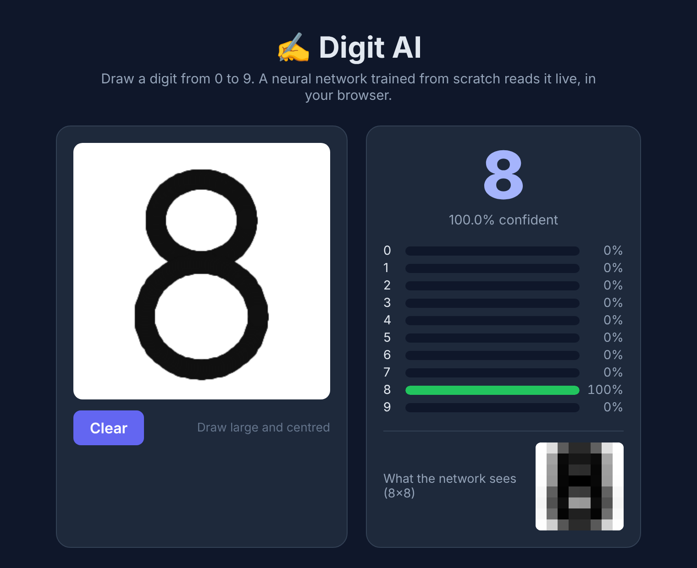
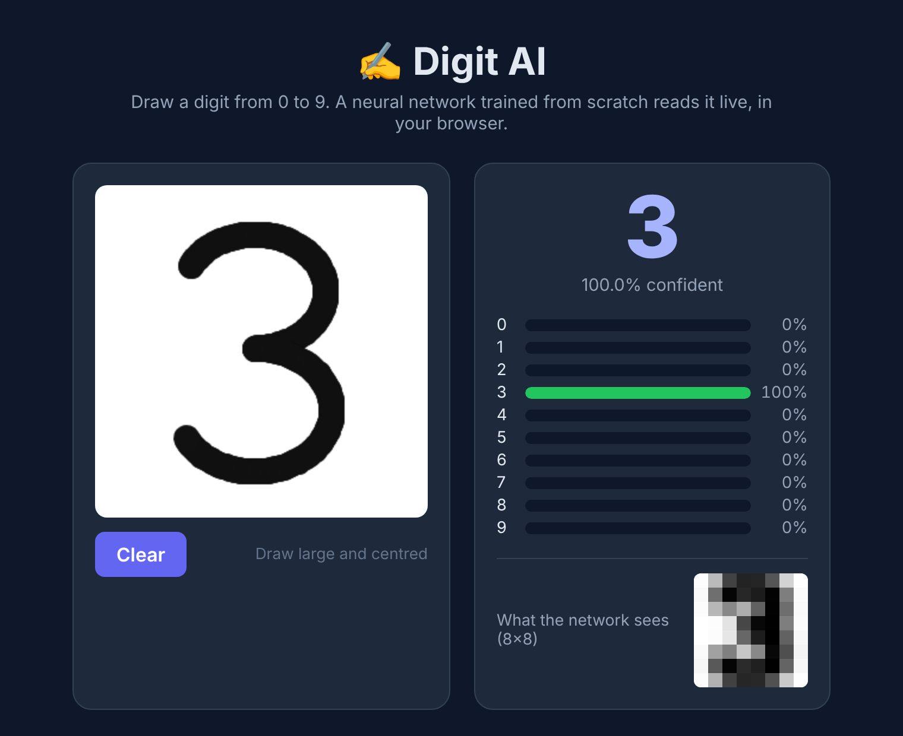
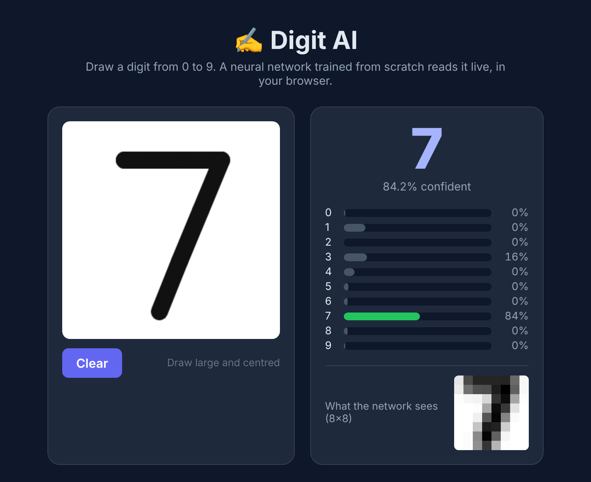
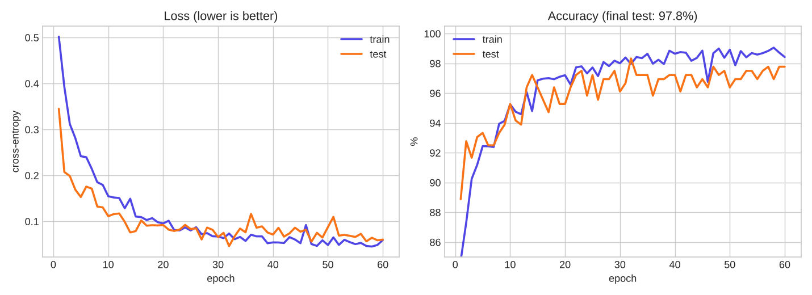
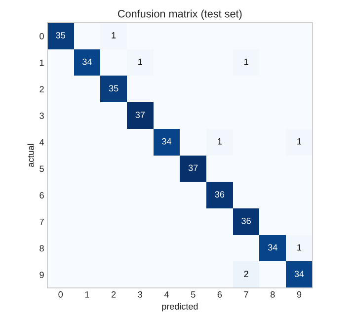
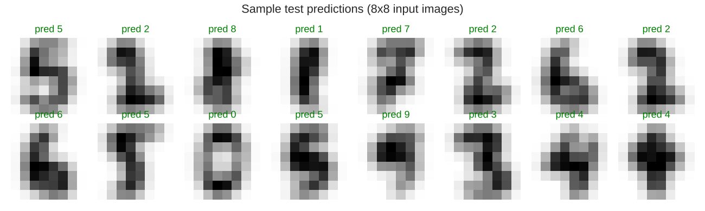

# ✍️ Digit AI: Handwritten Digit Recognizer

Draw a digit in your browser and a **neural network written from scratch in NumPy** recognizes it live.
No PyTorch, no TensorFlow: the forward pass, backpropagation and the Adam optimizer are all hand-written.

| Drawing an 8 | Drawing a 3 | Drawing a 7 |
|---|---|---|
|  |  |  |

## Results

- **97.8% accuracy** on 360 test digits the network never saw during training
- 9 of 10 digits drawn with a mouse in the app were recognized correctly (see *Known limitations*)



| Confusion matrix | Sample predictions |
|---|---|
|  |  |

## Quick start

**Use the app (no install):** open `web/index.html` in your browser.

**Retrain the model:**
```bash
pip install -r requirements.txt
python training/train.py      # ~20 s: trains, saves charts, exports web/model.js
node web/test.js              # checks the browser model matches the Python model
```

## How it works

### 1. The data
The [UCI handwritten digits](https://archive.ics.uci.edu/dataset/80) dataset that ships with scikit-learn: 1,797 digits written by real people, each 8×8 pixels. 80% is used for training and 20% is held back for testing.

### 2. The network (`training/network.py`)
```
64 pixels  →  128 hidden neurons (ReLU)  →  10 outputs (softmax = probability of each digit)
```
- **Forward pass:** multiply the inputs by the weights, apply ReLU (`max(0, x)`), then softmax to turn the scores into probabilities.
- **Loss:** cross-entropy, which punishes confident wrong answers heavily.
- **Backpropagation:** the chain rule works out how much each weight contributed to the error.
- **Adam optimizer:** gradient descent with momentum and an adaptive step size for each weight.
- **L2 regularization:** a small penalty on large weights to reduce overfitting.

### 3. Training data that looks like real drawings (`training/preprocess.py`)
The first version scored 98% on the test set but **misread drawings in the app**. The cause was *train/serve skew*: the app prepared its images differently from the training data. The fixes:
- **One shared pipeline:** crop to the ink, fit into a 32×32 box, blur, average down to 8×8, normalize. Python runs it for training and `web/nn.js` runs the same steps in the browser.
- **Augmentation:** every training digit is copied 12 times with random width, slant, rotation and pen thickness (17,244 training images in total).
- **Stroke thickening:** a pen line shrunk into the box is thinner than the dataset's strokes, so the app thickens it (dilation) before predicting.

### 4. In the browser (`web/`)
`train.py` exports the trained weights to `web/model.js`, and `nn.js` runs the same math in JavaScript. `web/test.js` checks that the browser's probabilities match Python's to within 0.001.

## Project structure

```
training/
  network.py       # neural network from scratch (forward, backprop, Adam)
  preprocess.py    # shared image pipeline + augmentation
  train.py         # trains, evaluates, saves charts, exports the model
  history.json     # loss/accuracy for each epoch
web/
  index.html, style.css, app.js   # drawing UI
  nn.js            # preprocessing + forward pass in JavaScript
  model.js         # trained weights (generated)
  test.js          # JS ↔ Python parity test
screenshots/       # app screenshots and training charts
```

## Known limitations

- The dataset is small (1,797 digits at 8×8), so unusual handwriting can fool it.
- **6** is the weakest digit: a 6 with a big round loop and a short top can be read as 5 or 1.
- A **1 with a long flag** can be read as 3. Plain or slightly slanted 1s work well.
- Tip: draw large, centred, and fill most of the box.

## Ideas to extend

- Train on MNIST (70,000 digits at 28×28) for much better real-world accuracy
- Add a convolutional layer
- Let users correct wrong guesses and save them as new training data

## License

MIT
